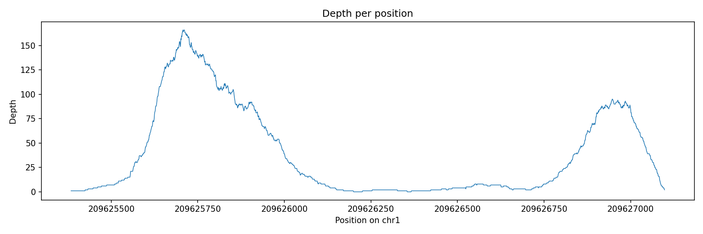
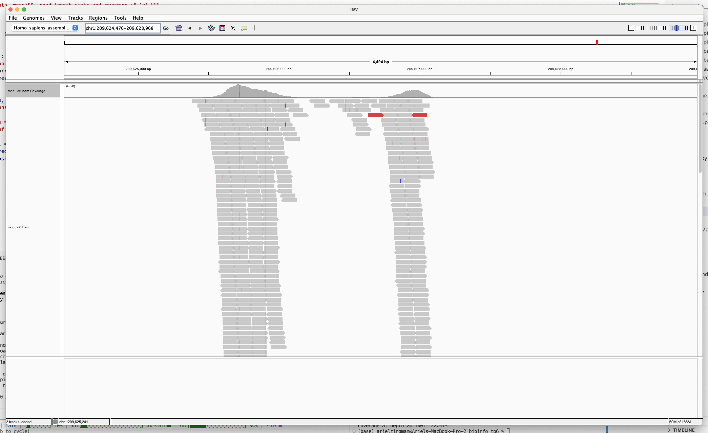
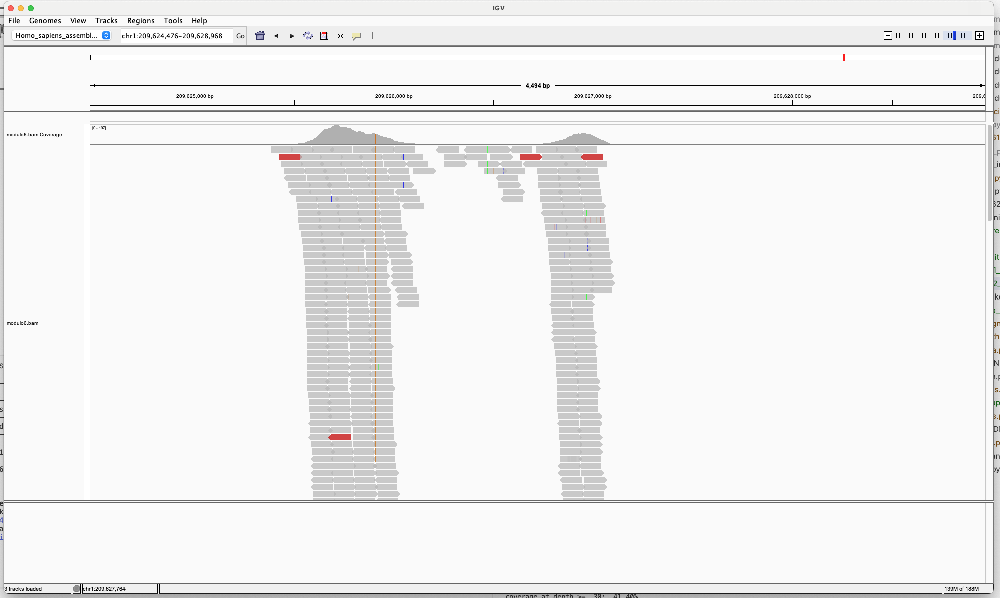
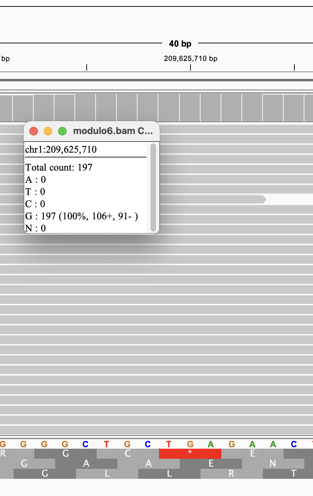
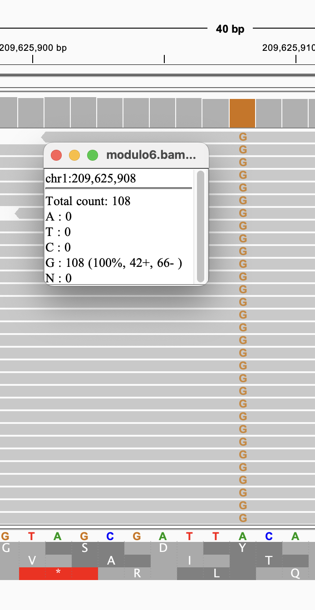
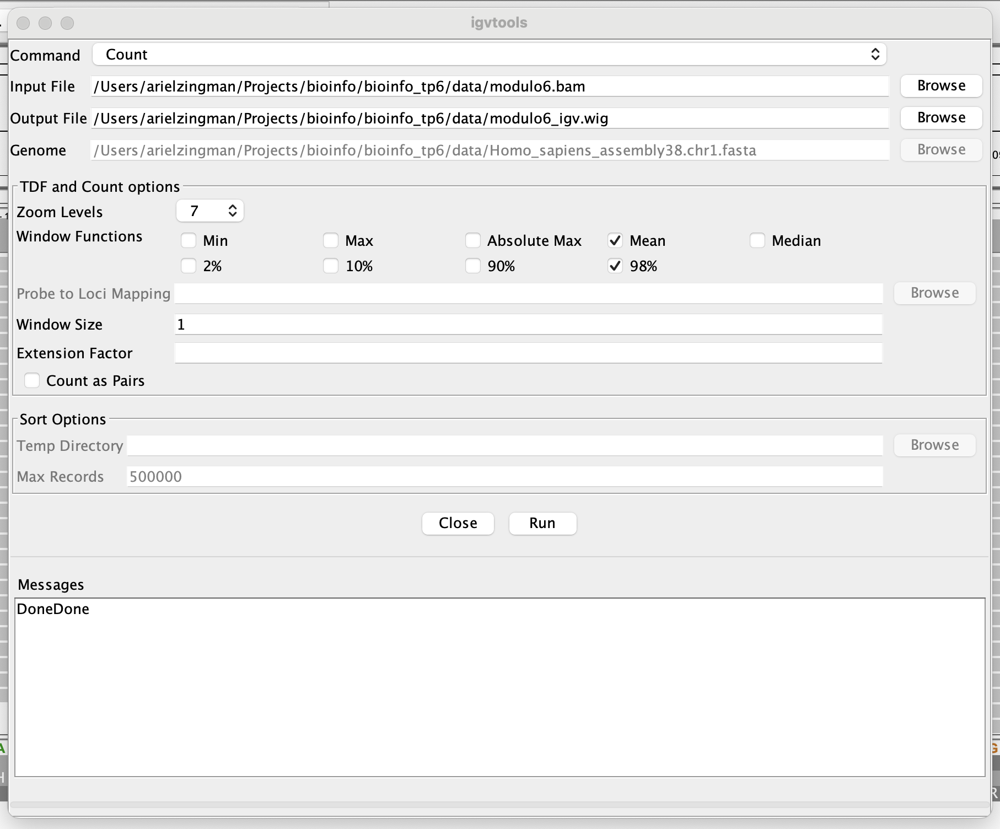
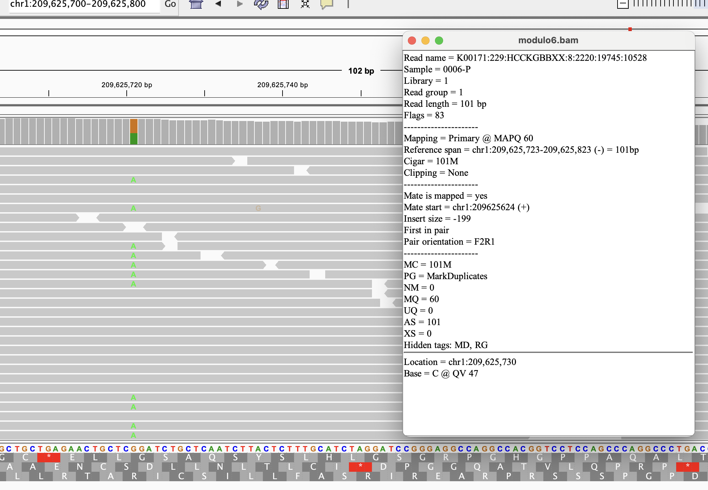

# TP 6: mapeo y llamado de variantes (NGS)

Este TP trabaja sobre un experimento de secuenciación masiva ya mapeado contra el cromosoma 1 del genoma humano (hg38). Primero (6.1) se miden las métricas del mapeo a partir del archivo SAM y se comparan contra el IGV; después (6.2) se determinan las variantes y se escribe un archivo tipo VCF para compararlo contra el de GATK.

Los ejercicios están resueltos en `exercises/` y se corren en la consola con `python3 main.py <ejercicio>` (por ejemplo `python3 main.py 6.1a-ii`). Sin argumentos lista los ejercicios disponibles.

---

## Datos

| Archivo | Qué es |
|---|---|
| `data/modulo6.sam` (y `.bam`/`.bai`) | 772 lecturas ya mapeadas con BWA contra chr1 de hg38 |
| `data/Homo_sapiens_assembly38.chr1.fasta.gz` | cromosoma 1 de referencia (248.956.422 bases) |
| `data/modulo6.vcf` | variantes llamadas por GATK, para comparar en 6.2 |

Las 772 lecturas miden todas 101 bases, y 767 de ellas son `101M` (se alinean enteras). Las otras cinco tienen un recorte (*soft-clip*, `S`) en alguno de los extremos: `94M7S`, `7S94M`, `96M5S`, `5S96M` y `82M19S`.

Las lecturas cubren una región chica: `chr1:209.625.384–209.627.098`, 1715 posiciones de las casi 249 millones del cromosoma. Es la ventana que tomamos como "genoma target" en todo 6.1.

---

## Cómo leemos el SAM: la estructura de datos

Queríamos tener cargados juntos la referencia y las lecturas, y poder preguntar fácil cosas como "qué bases hay en esta posición". Una matriz sobre todo el cromosoma quedaba descartada (casi todo ceros), así que armamos una clase `Pileup` (`pileup.py`) que solo guarda la ventana cubierta:

```
start   primera posición cubierta por alguna lectura (1-based, como POS en el SAM)
ref     bases de la referencia en la ventana (un string)
pile    pile[i] = {base: cantidad} para la posición start + i
```

Cada posición tiene su propio contador con las bases que aparecen ahí (`{'A': 40, 'G': 12}`). Se arma con una sola pasada por las lecturas, recorriendo el CIGAR de cada una: las `M` suman la base de la lectura en la posición correspondiente, las `D` suman una deleción (`'*'`) y las `S` y `I` consumen bases de la lectura sin tocar la referencia. La profundidad de una posición es la suma de su contador (`depth_at`).

La referencia se lee del `.gz` sin cargar el cromosoma entero: como el fasta tiene 60 bases por línea, calculamos en qué línea cae la ventana y leemos solo esas (`fetch_reference` en `pileup.py`).

---

## 6.1a: métricas del mapeo

### Qué hicimos primero, y qué nos faltaba

En la primera versión contamos **todas** las lecturas del SAM. Con eso salieron los números de la columna "antes" de esta sección. Recién cuando llegamos al IGV (6.1b) nos dimos cuenta de que no coincidían con los del IGV, y descubrimos por qué: el BAM tiene lecturas marcadas como **duplicados** (flag 1024, puesto por MarkDuplicates) y el IGV las excluye por defecto, mientras que nosotros las estábamos contando. Lo contamos en detalle en la sección de 6.1b; acá van los resultados finales, ya sin duplicados, junto a los primeros.

Hay 118 duplicados entre las 772 lecturas. Todos los números "después" de esta sección excluyen esas 118.

### i) Profundidad por posición



La profundidad tiene dos picos, uno grande (máximo 166 lecturas, cerca de la posición 209.625.707) y otro más chico (95 lecturas) cerca de 209.626.947, separados por un valle de profundidad muy baja (entre 0 y 8 lecturas). Hay 38 posiciones con profundidad 0.

### ii) Profundidad promedio y desvío estándar

Sobre las 1715 posiciones de la ventana (las que no cubre ninguna lectura cuentan como 0):

| | Antes (con duplicados) | Después (sin duplicados) |
|---|---|---|
| Media | 45,44 | **38,50** |
| SD | 54,72 | **45,56** |
| Máximo | 197 | 166 |

El SD es alto respecto de la media porque la profundidad no es pareja: los dos picos y el valle del medio hacen que la distribución sea muy dispersa.

### iii) Largo de las lecturas

Media 101 y SD 0 sobre las 772 lecturas: todas miden exactamente 101 bases (largo de `SEQ`, que incluye las bases recortadas por `S`).

### iv) Cobertura

Porcentaje de las 1715 posiciones de la ventana con profundidad mayor o igual al umbral:

| Umbral | Antes (con duplicados) | Después (sin duplicados) |
|---|---|---|
| ≥ 1 | 97,78% | 97,78% |
| ≥ 5 | 67,81% | 67,76% |
| ≥ 10 | 53,70% | 52,42% |
| ≥ 20 | 45,48% | 45,07% |
| ≥ 30 | 41,40% | 40,35% |
| ≥ 50 | 34,29% | 32,59% |
| ≥ 100 | 22,51% | **12,77%** |

La cobertura con umbral 1 no cambia porque los duplicados caen sobre posiciones que otras lecturas ya cubren. Donde sí se nota es en los umbrales altos: los duplicados se concentran en los picos, que son las únicas zonas que pasan de 100 lecturas, así que a ≥ 100 la cobertura se cae de 22,5% a 12,8%.

---

## 6.1b: comparación con el IGV

Cargamos el genoma `Homo_sapiens_assembly38.chr1.fasta` y `modulo6.bam`, y miramos la región `chr1:209.624.476–209.628.968`.

### La profundidad por posición



*Vista general con la configuración por defecto del IGV: la pista de cobertura (arriba) tiene la misma forma que nuestro gráfico, pero su eje llega solo hasta 166 (`[0 - 166]`).*

La forma coincide con nuestro gráfico, pero el máximo no: el IGV marca 166 y nosotros habíamos medido 197. Ahí fue cuando sospechamos de los duplicados. Lo comprobamos de dos maneras:

1. Contamos cuánto valdría nuestro máximo si excluyéramos las lecturas con el flag 1024 puesto: da exactamente 166.
2. Apagamos el filtro en el IGV (*View → Preferences → Alignments → Filter duplicate reads*), recargamos el BAM, y el eje pasó a `[0 - 197]`, igual que nuestro máximo original.



*La misma región con el filtro de duplicados apagado: el eje ahora es `[0 - 197]`, igual al máximo que habíamos calculado contando todas las lecturas.*

### La profundidad en posiciones concretas

Comparamos el popup de la pista de cobertura con nuestro `Pileup` (con el filtro de duplicados apagado, para comparar contra nuestra primera versión):

| Posición | IGV | Nuestro `Pileup` |
|---|---|---|
| `chr1:209.625.710` (el máximo) | Total 197, `G: 197` (106+, 91−) | `{'G': 197}`, profundidad 197 |
| `chr1:209.625.908` (variante de GATK) | Total 108, `G: 108` (42+, 66−) | `{'G': 108}`, profundidad 108, ref `A` |
| `chr1:209.625.724` | Total 190, `T: 189`, `A: 1` | `{'T': 189, 'A': 1}`, profundidad 190, ref `T` |





El conteo base por base coincide en las tres posiciones. La segunda es una de las variantes del VCF de GATK: la referencia dice `A` y las 108 lecturas dicen `G`, una variante homocigota A>G (en el IGV se ve como una barra naranja en la cobertura). La tercera es un ejemplo de error de secuenciación: una sola `A` entre 190 lecturas (1%). Una diferencia así no se considera variante.

### Media, SD y cobertura

El IGV no da media ni SD directamente, así que usamos `Tools → Run igvtools → Count` sobre el BAM, con el tamaño de ventana en 1 (una línea por posición), y leímos el `.wig` resultante (`data/modulo6_igv.wig`).



Comparado posición por posición contra nuestro `Pileup`:

| | Posiciones donde difiere del IGV |
|---|---|
| Contando todas las lecturas | 1133 de 1677 |
| **Excluyendo duplicados** | **0 de 1677** |

(El `.wig` solo tiene las 1677 posiciones con profundidad mayor a 0.)

Desde ahí excluimos los duplicados en el código (`skip_duplicates=True`, igual que hace GATK), y con eso nuestra profundidad coincide con la del IGV en todas las posiciones. La media (38,50) y el SD (45,56) calculados sobre las 1715 posiciones de la ventana, rellenando con 0 las que el `.wig` omite, son las mismas que las nuestras de la sección anterior.

### Largo de las lecturas



El popup de una lectura muestra `Read length = 101 bp`, `Cigar = 101M` y `Clipping = None`, igual que lo que leemos del SAM para esa lectura (`K00171:229:HCCKGBBXX:8:2220:19745:10528`, flag 83, POS 209625723). Sirve para ver que el IGV y nuestro parser leen lo mismo del archivo.

---

## 6.2b: variantes

El programa tiene dos partes, como pide el enunciado (`python3 main.py 6.2b-i` y `python3 main.py 6.2b-ii`).

### i) Todas las potenciales variantes

Con el mismo `Pileup` de 6.1, una potencial variante es cualquier base observada en una posición que no sea la de la referencia (`alts_at` en `variants.py`). Para cada par (posición, alternativa) `candidate_variants` guarda lo que pide el enunciado: la profundidad de la posición (a) y la profundidad de la variante, o sea cuántas lecturas la respaldan (b).

Salen **93 potenciales variantes** (con los duplicados excluidos, como en 6.1). Casi todas son ruido:

| Lecturas que respaldan la alternativa | Cantidad de candidatas |
|---|---|
| 1 | 82 |
| 2 | 7 |
| 3 | 1 |
| 4 | 1 |
| 69 | 1 |
| 89 | 1 |

Hay una brecha enorme entre las dos últimas y el resto: 69 y 89 lecturas contra 4 como máximo. De las 93, 37 son una `N` (base no determinada por el secuenciador) y 56 son un cambio de base.

### ii) Filtro por umbrales

Una candidata se queda si cumple tres cosas, con los umbrales como constantes al principio de `variants.py`:

| Umbral | Valor | Para qué |
|---|---|---|
| Profundidad mínima de la posición (`MIN_DEPTH`) | 10 | con pocas lecturas no se puede confiar en la proporción |
| Fracción alternativa heterocigota (`HET_MIN_FRACTION`) | de 0,20 a 0,80 | una heterocigota ronda el 50% |
| Fracción alternativa homocigota (`HOM_MIN_FRACTION`) | desde 0,80 | una homocigota ronda el 100% |
| Lecturas alternativas mínimas (`MIN_ALT_HET`, `MIN_ALT_HOM`) | 5 | no aceptar una proporción alta con muy pocas lecturas |

La fracción alternativa es `profundidad de la variante / profundidad de la posición`, y decide si es `0/1` o `1/1`. Quedan **dos variantes**, que se escriben en `data/modulo6_mycalls.vcf`:

```
##fileformat=VCFv4.2
#CHROM  POS        ID  REF  ALT  QUAL  FILTER  INFO
chr1    209625721  .   G    A    .     PASS    DP=159;AD=69;AF=0.434;GT=0/1
chr1    209625908  .   A    G    .     PASS    DP=89;AD=89;AF=1.000;GT=1/1
```

### Qué pasa si cambiamos los umbrales

El resultado es muy estable. Variamos cada umbral dejando el otro fijo:

| `MIN_ALT` (con `MIN_DEPTH` = 10) | Variantes que quedan |
|---|---|
| 1 a 60 | 2 |
| 70 | 1 (se cae la heterocigota, que tiene 69) |

| `MIN_DEPTH` (con `MIN_ALT` = 1) | Variantes que quedan |
|---|---|
| 1 | 6 |
| 3 | 5 |
| 5 y 6 | 3 |
| 7 a 10 | 2 |

Los dos umbrales hacen trabajos distintos. En las posiciones profundas, el ruido (una lectura entre 100 o más) queda muy por debajo del 20% de fracción alternativa, así que lo descarta la fracción. El problema son las posiciones con pocas lecturas, donde una sola lectura es una fracción grande. Con `MIN_DEPTH` en 1 pasan cuatro falsos positivos, todos con muy poca profundidad: `209625426` (2 lecturas, 1 alternativa), `209626474` (3 y 3), `209626503` (4 y 1) y `209625479` (6 y 4). Con `MIN_DEPTH` en 7 o más desaparecen. Por eso el piso de profundidad es el umbral que más importa, y 10 es un valor con margen de sobra.

### Comparación con GATK

El `modulo6.vcf` de la cátedra tiene exactamente dos variantes, y son las mismas que las nuestras:

| | Posición | REF>ALT | Genotipo | Profundidad | Lecturas alternativas |
|---|---|---|---|---|---|
| GATK | 209625721 | G>A | 0/1 | 157 | 68 |
| **Nuestro** | 209625721 | G>A | 0/1 | 159 | 69 |
| GATK | 209625908 | A>G | 1/1 | 85 | 85 |
| **Nuestro** | 209625908 | A>G | 1/1 | 89 | 89 |

Coinciden las posiciones, los alelos y el genotipo. La profundidad difiere en 2 lecturas en la primera y en 4 en la segunda, y las lecturas alternativas en 1 y 4.

En `209625721` hay una base `G` de calidad 3 que nosotros contamos y GATK descarta, porque su calidad mínima es 10. Eso explica 1 de las 2 lecturas de diferencia en la profundidad (159 contra 157).

Nos quedan sin explicar 1 lectura de diferencia en `209625721` (68 contra 69) y 4 en `209625908` (85 contra 89). Revisamos la calidad de mapeo y la orientación de las parejas, entre otras cosas, y no encontramos la causa. No cambia lo importante: son las mismas dos variantes, con el mismo genotipo.

### Qué le falta a nuestro VCF

No calculamos `QUAL` ni usamos las calidades de base y de mapeo: decidimos solo por conteos de lecturas. GATK usa las calidades y un modelo probabilístico de genotipos (`GQ`, `PL`) y filtra por sesgo de hebra. Con una cobertura tan alta como la de estas dos posiciones los conteos alcanzan, pero en una región de cobertura baja y dudosa convendría pesar cada lectura por su calidad.

---

## Sobre el código

- `main.py`: corre un ejercicio por nombre (`python3 main.py 6.1a-i`, y así).
- `exercises/ex61/`, `exercises/ex62/`: un archivo por ejercicio, con una función por ítem.
- `pileup.py`: lectura del SAM (y del CIGAR), lectura de la referencia y la clase `Pileup` que describimos arriba.
- `depth.py`: media, SD y cobertura.
- `variants.py`: potenciales variantes, filtro por umbrales y escritura del VCF (6.2). El resultado queda en `data/modulo6_mycalls.vcf`.
- `plots.py`: gráficos.
- `paths.py`: rutas a los datos.

El fasta descomprimido (253 MB) y el `.gz` (69 MB) no están en el repositorio por su tamaño; hay que ponerlos a mano en `data/` después de clonar.
